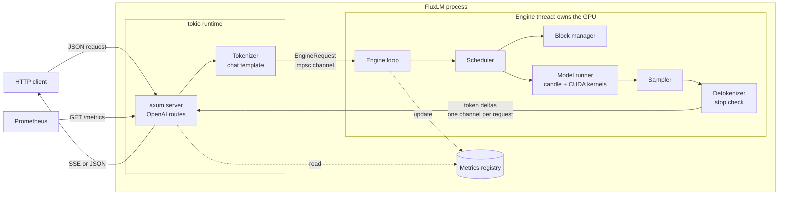
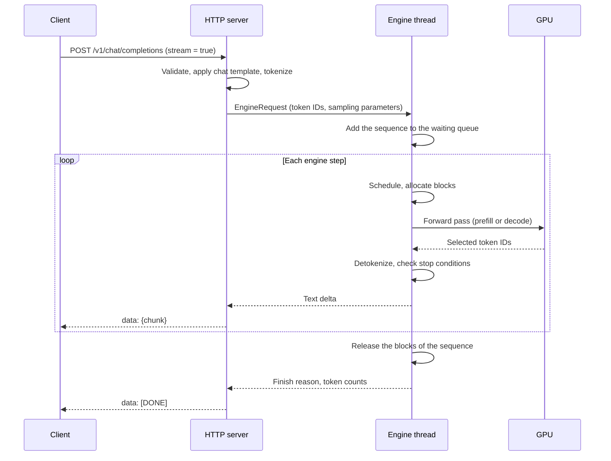
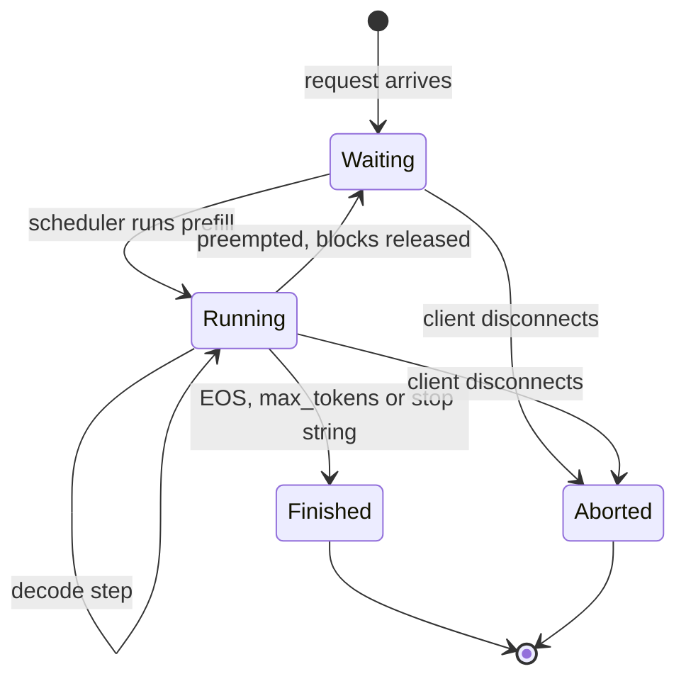
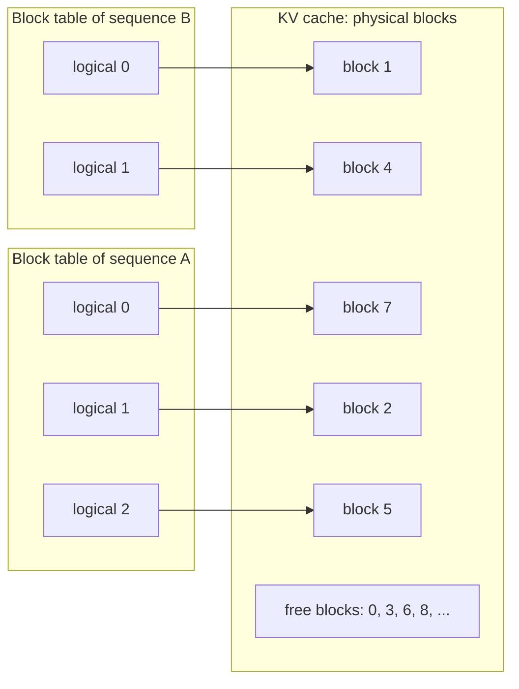
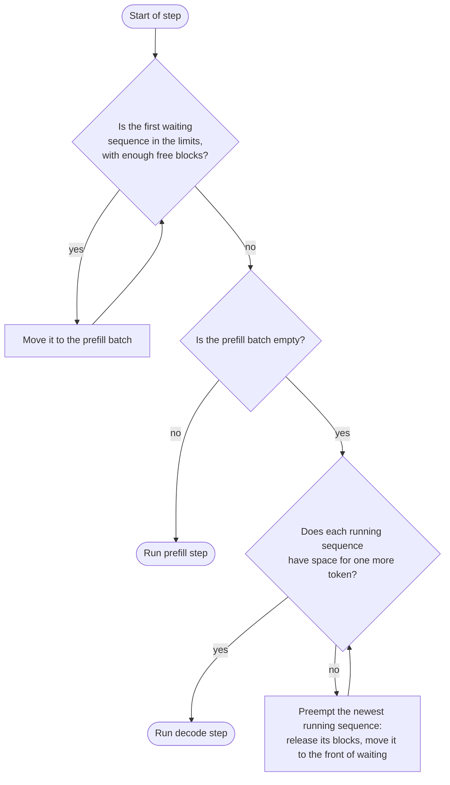

# FluxLM

[](LICENSE)
[](https://www.rust-lang.org)
[](https://developer.nvidia.com/cuda-toolkit)
[](https://huggingface.co/meta-llama)
[](https://platform.openai.com/docs/api-reference)

FluxLM is an inference server for large language models (LLMs). It is written in Rust.
FluxLM uses the main ideas of [vLLM](https://github.com/vllm-project/vllm):
a paged KV cache, continuous batching and an OpenAI-compatible HTTP API.

The first version (MVP) serves one Llama 3.x model on one NVIDIA GPU.
Later versions add chunked prefill, prefix caching, CUDA Graphs, quantization and more model architectures.

## Contents

- [Why FluxLM](#why-fluxlm)
- [Goals and non-goals](#goals-and-non-goals)
- [Terms](#terms)
- [Architecture](#architecture)
- [Roadmap](#roadmap)
- [API reference](#api-reference)
- [Metrics](#metrics)
- [Configuration](#configuration)
- [Requirements](#requirements)
- [Build and run](#build-and-run)
- [Tests and benchmarks](#tests-and-benchmarks)
- [Project layout](#project-layout)
- [License](#license)

## Why FluxLM

vLLM does most of its GPU work in CUDA kernels. Its scheduler, its batch preparation and its HTTP server run in Python.
For small models and large batches, this CPU work can take a large part of each decode step.

FluxLM moves all of this CPU work to Rust. The scheduler, the block manager, the tokenizer and the HTTP server
run as native code in one process. They use no Python interpreter and no global interpreter lock.

FluxLM is also a learning project. The code base is small, so that one person can read all of it
and see how a modern LLM server works.

## Goals and non-goals

**Goals**

- Serve one Llama 3.x model on one NVIDIA GPU through an OpenAI-compatible API.
- Use GPU memory efficiently with a paged KV cache.
- Keep the GPU busy with continuous batching.
- Keep the CPU time for each engine step low.
- Give correct output. The output of FluxLM must match Hugging Face `transformers` for the same model and the same input.
- Expose the main server values (queue sizes, KV cache usage, latency) as Prometheus metrics.

**Non-goals for the MVP**

- More than one GPU.
- CPU inference, AMD GPUs and Apple GPUs.
- Training and fine-tuning.
- Support for every option that vLLM has.

## Terms

| Term | Meaning |
|---|---|
| Sequence | One request and the tokens that the model generated for it. |
| KV cache | GPU memory that keeps the attention keys (K) and values (V) of all earlier tokens. The model reads it at each decode step. |
| Block | A fixed-size part of the KV cache. One block holds the keys and values of `block_size` tokens for all layers. |
| Block table | A list of block IDs for one sequence. Entry *i* holds the tokens at positions `i*block_size` to `(i+1)*block_size - 1`. |
| Slot | The position of one token in the KV cache: `block_id * block_size + offset`. |
| Prefill | The forward pass over all prompt tokens. It writes the KV cache for the prompt and gives the first output token. |
| Decode | One forward pass that gives one new token for each running sequence. |
| Continuous batching | The scheduler adds and removes sequences at each step. It does not wait for a full batch to finish. |
| Preemption (recompute) | The scheduler stops a sequence and releases its blocks. Later, the sequence runs prefill again on its prompt and its generated tokens. |
| TTFT | Time to first token: the time from request arrival to the first output token. |
| TPOT | Time per output token: `(time of last token - time of first token) / (output tokens - 1)`. |

## Architecture

### Components



| Component | Responsibility |
|---|---|
| HTTP server | Parses OpenAI requests. Validates the fields. Sends the response as JSON or as an SSE stream. |
| Tokenizer | Renders the chat template. Converts text to token IDs. Converts output token IDs to text, one token at a time. |
| Engine loop | Runs the steps of the model. Receives new requests and sends output to the HTTP side. |
| Scheduler | Selects the sequences for each step. Obeys the batch limits. Preempts sequences when no free block is available. |
| Block manager | Owns the list of free KV cache blocks. Allocates and releases blocks. Keeps the block table of each sequence. |
| Model runner | Makes the input tensors for a step. Runs the Llama forward pass on the GPU. Returns the logits of the last token of each sequence. |
| Sampler | Applies temperature, top-k and top-p to the logits. Selects one token for each sequence. |
| Metrics registry | Keeps the Prometheus counters, gauges and histograms. |

### Threads and channels

The HTTP server and the engine are in the same process.

- The tokio runtime runs the HTTP server. Tokenization runs in `spawn_blocking`, so that it does not stop other requests.
- One engine thread owns the GPU. Only this thread uses CUDA, so the GPU state needs no locks.
- The HTTP side sends each new request to the engine through one `mpsc` channel.
- The engine sends output to the HTTP side through one channel for each request.
- If a client closes the connection, its output channel closes. The engine sees this and stops the request.

### Request flow



### Engine loop

The engine does these steps again and again:

1. Receive new requests from the request channel. Add them to the `waiting` queue.
2. The scheduler selects the sequences for this step. The result is a prefill batch or a decode batch.
3. The block manager allocates KV cache blocks for the new tokens of these sequences.
4. The model runner makes the input tensors and runs one forward pass.
5. The sampler selects one token for each sequence.
6. The engine detokenizes the new tokens and checks the stop conditions. It sends the new text to each client.
7. The block manager releases the blocks of the finished and the stopped sequences.
8. The engine updates the metrics.

If no sequence is in the `waiting` queue or the `running` queue, the engine thread waits on the request channel.
It does not use CPU time when the server has no work.

### Sequence states



### Paged KV cache

The KV cache is one large set of blocks. A sequence does not get one contiguous memory area.
It gets blocks one at a time, when it needs them. The block table maps the logical blocks of a sequence to physical blocks.



This design has two advantages:

- Memory waste is less than one block for each sequence. A contiguous cache must reserve memory for the maximum length.
- The server can keep more sequences in the cache at the same time. Thus the batch size and the throughput increase.

## Roadmap

| Priority | Item | Summary |
|---|---|---|
| P0 | Model loading | `safetensors` and `config.json`, Llama 3.x, FP16/BF16, one GPU |
| P0 | Tokenizer | Hugging Face `tokenizers`, chat template |
| P0 | Paged KV cache | Block manager, block tables, paged attention kernel for decode |
| P0 | Scheduler | Continuous batching, `waiting`/`running` queues, batch limits, preemption by recompute |
| P0 | Sampling | Greedy, temperature, top-k, top-p, seed, EOS, `max_tokens`, stop strings |
| P0 | OpenAI API | `/v1/completions`, `/v1/chat/completions`, SSE streaming |
| P0 | Observability | `/health`, Prometheus metrics |
| P1 | Chunked prefill | Long prompts do not stop decode steps |
| P1 | Prefix caching | Reuse KV cache blocks with the same content |
| P1 | CUDA Graphs | Less kernel launch overhead in decode |
| P1 | Quantization and models | FP8 or AWQ, Qwen2/3 and Mistral |
| P2 | Scale and features | Tensor/pipeline parallelism, speculative decoding, multi-LoRA, structured output, multimodal input |

### P0: MVP (required)

#### P0.1 Model loading

The loader reads a Hugging Face model directory. The directory must contain `config.json`, the weights and the tokenizer files.

- Read `config.json` into a Rust struct with `serde`. FluxLM uses these fields:
  `hidden_size`, `intermediate_size`, `num_hidden_layers`, `num_attention_heads`, `num_key_value_heads`,
  `rms_norm_eps`, `rope_theta`, `rope_scaling`, `vocab_size`, `max_position_embeddings`,
  `tie_word_embeddings` and `torch_dtype`.
- Reject a model if `architectures` is not `LlamaForCausalLM`. The error message names the architecture.
- Read the weights from `*.safetensors` files. For a model in more than one file, read `model.safetensors.index.json`.
- Map the files into memory with `memmap2`. Copy each tensor to the GPU one time. The weights do not stay in CPU memory.
- Support FP16 and BF16. If `--dtype` is `auto`, use `torch_dtype` from `config.json`.
- Support one GPU.

The Llama 3.x decoder layer has these parts:

1. RMSNorm on the input.
2. Grouped-query attention (GQA). The Q, K and V projections have no bias. RoPE uses the `llama3` frequency scaling.
3. A residual connection.
4. RMSNorm.
5. A SwiGLU MLP: `down_proj(silu(gate_proj(x)) * up_proj(x))`.
6. A residual connection.

After the last layer, the model applies a final RMSNorm and the `lm_head` projection.
If `tie_word_embeddings` is `true`, `lm_head` uses the embedding weights.

**Done when:** for a set of fixed prompts, the top-1 token at each position is the same as in Hugging Face `transformers`.

#### P0.2 Tokenizer and chat template

- Load `tokenizer.json` with the [`tokenizers`](https://github.com/huggingface/tokenizers) crate.
- Read `chat_template` from `tokenizer_config.json`. Render it with `minijinja`.
  The server sets `add_generation_prompt = true`, so the prompt ends with the start of the assistant turn.
- Read the EOS token IDs from `generation_config.json`. Llama 3.x has more than one EOS token (for example `<|eot_id|>`).
- Detokenize incrementally. For each new token, decode a short window of earlier tokens plus the new token.
  Send only the new text. If the new text ends with an incomplete UTF-8 character, keep it until the next token.

**Done when:** for a set of test inputs, the token IDs and the rendered chat prompt are the same as in `transformers`.

#### P0.3 Paged KV cache, block manager and paged attention

**Memory size.** At start, the engine calculates the number of KV cache blocks:

1. Load the weights.
2. Run one forward pass with `--max-num-batched-tokens` tokens. Record the peak GPU memory.
3. Calculate `free = total_gpu_memory * gpu_memory_utilization - peak_memory`.
4. Calculate `num_blocks = free / block_bytes`.

The size of one block is:

```text
block_bytes = 2 (K and V) * num_layers * num_kv_heads * head_dim * dtype_bytes * block_size
```

| Model | Bytes for one token | Bytes for one block (16 tokens) |
|---|---|---|
| Llama 3.2 1B (16 layers, 8 KV heads, head_dim 64, BF16) | 32 KiB | 512 KiB |
| Llama 3.1 8B (32 layers, 8 KV heads, head_dim 128, BF16) | 128 KiB | 2 MiB |

**Cache layout.** Each layer has one K tensor and one V tensor.
The shape of each tensor is `[num_blocks, block_size, num_kv_heads, head_dim]`. The default block size is 16 tokens.

**Block manager.**

- It keeps a free list of block IDs.
- `allocate` removes one block from the free list. `release` puts the blocks of a sequence back on the free list.
- Each block has a reference count. P0 does not need the count, but prefix caching (P1) uses it.
- Each sequence has a block table (`Vec<u32>`). A sequence gets a new block when its last block is full.

**Kernels.**

- `reshape_and_cache` writes the new K and V values of each token into its slot.
  The input `slot_mapping` gives one slot for each token.
- Prefill attention: a causal attention over the prompt tokens. P0 uses candle operations
  (matrix multiply, mask and softmax) for each sequence.
- Decode attention: a custom CUDA kernel. Each sequence has one query token.
  The kernel reads K and V through the block table of the sequence.
  It uses an online softmax, so that it reads each block one time.
  For GQA, query head `h` uses KV head `h / (num_heads / num_kv_heads)`.

Decode kernel inputs:

| Input | Shape | Description |
|---|---|---|
| `query` | `[num_seqs, num_heads, head_dim]` | Query of the new token. |
| `k_cache`, `v_cache` | `[num_blocks, block_size, num_kv_heads, head_dim]` | KV cache of one layer. |
| `block_tables` | `[num_seqs, max_blocks_per_seq]` | Block table of each sequence, padded. |
| `context_lens` | `[num_seqs]` | Number of tokens in the cache for each sequence. |
| `scale` | scalar | `1 / sqrt(head_dim)`. |

**Done when:**

- The output of the paged decode kernel is the same as the output of attention on a contiguous cache, within a set tolerance.
- After 10,000 random allocate and release operations, the block manager has no lost blocks.

#### P0.4 Scheduler with continuous batching

The scheduler has two queues:

- `waiting`: new requests and preempted sequences. First in, first out.
- `running`: sequences with a full KV cache that are in the decode phase.

Each step obeys two limits:

- `--max-num-seqs`: the maximum number of sequences in one step.
- `--max-num-batched-tokens`: the maximum number of tokens in one step.
  For prefill, each sequence adds all its prompt tokens. For decode, each sequence adds one token.



Rules:

- A prefill step and a decode step do not mix in P0. Chunked prefill (P1) removes this limit.
- The scheduler gives priority to prefill. This gives a low TTFT, but a long prompt can delay the decode of other sequences.
- Preemption uses recompute. The scheduler releases all blocks of the preempted sequence.
  Later, the sequence runs prefill again on its prompt plus the tokens that it generated.
  The client sees no change in the output.
- The scheduler preempts the newest sequence first. Thus older requests finish first.
- If a prompt is longer than `--max-model-len`, the server returns HTTP 400. The engine never receives this request.

**Done when:** a test sends many requests to a server with a small KV cache. All requests finish.
With greedy sampling, the outputs are the same as the outputs of a run without preemption.

#### P0.5 Sampling and stop conditions

Sampling parameters:

| Parameter | Default | Effect |
|---|---|---|
| `temperature` | 1.0 | Divides the logits. If the value is 0, the sampler uses greedy selection (argmax). |
| `top_k` | -1 (off) | Keeps only the `k` tokens with the highest probability. |
| `top_p` | 1.0 (off) | Keeps the smallest set of tokens with a total probability of `p` or more. |
| `seed` | none | Initializes the random number generator of the request. |
| `max_tokens` | 16 for completions, until the context ends for chat | Maximum number of output tokens. |
| `stop` | none | One string or a list of up to 4 strings. |

The sampler applies the operations in this order:

1. Divide the logits by `temperature`.
2. Apply top-k.
3. Apply softmax.
4. Apply top-p. Calculate the probabilities again for the remaining tokens.
5. Select one token with inverse transform sampling.

Each request has its own random number generator (`ChaCha8`). The `seed` value initializes it.
For each step, the CPU makes one uniform random number for each sequence. The GPU uses this number to select the token.
Thus the output does not change when other requests are in the same batch.
With the same seed and the same input, the output is the same on the same hardware.

Sampling runs on the GPU for the full batch. Only the selected token IDs go to the CPU.

Stop conditions:

| Condition | `finish_reason` |
|---|---|
| The model generates an EOS token. | `"stop"` |
| The output text contains a stop string. The server does not return the stop string or the text after it. | `"stop"` |
| The sequence has `max_tokens` output tokens. | `"length"` |
| The sequence reaches `--max-model-len`. | `"length"` |

A stop string can go across more than one token. For streaming, the server keeps the end of the text
if it can be the start of a stop string. The server sends this text when it cannot match a stop string.

**Done when:** unit tests pass for each sampling mode and for stop strings that go across token boundaries.

#### P0.6 OpenAI-compatible API

The server implements the routes in the [API reference](#api-reference).

- The official `openai` client libraries must work with FluxLM without changes.
- For `stream = true`, the server sends Server-Sent Events (SSE). Each event is `data: <JSON chunk>`.
  The last event is `data: [DONE]`.
- A response without streaming has a `usage` object.
- If the client closes the connection, the engine stops the request and releases its blocks.

**Done when:** the official `openai` Python client works with both endpoints, with and without streaming.

#### P0.7 Observability

- `GET /health` returns HTTP 200 when the engine loop runs. It returns HTTP 503 if the engine thread stopped.
- `GET /metrics` returns the metrics in the Prometheus text format. The [Metrics](#metrics) section lists them.

**Done when:** Prometheus can read `/metrics`, and the values change correctly during a load test.

### P1: after the MVP

#### Chunked prefill

In P0, one long prompt fills a full step. All running sequences wait for this step, so their TPOT increases.

Chunked prefill divides a long prompt into chunks. One step can contain decode tokens and one prefill chunk:

1. The scheduler adds one token for each running sequence to the step.
2. The scheduler fills the remaining token budget with the next chunk of a waiting prompt.

This needs a prefill attention kernel that reads earlier tokens from the paged KV cache.

#### Prefix caching

Many requests start with the same text, for example the same system prompt.
Prefix caching lets these requests use the same KV cache blocks.

- Each full block gets a hash: `hash(hash of the previous block, token IDs of this block)`.
  Thus two blocks have the same hash only if all earlier tokens are also the same.
- A table maps each hash to a block ID.
- For a new request, the scheduler searches the table for the hashes of its blocks.
  It reuses each matching block and increases its reference count. Prefill runs only on the remaining tokens.
- A block with a reference count of 0 stays in the cache. The block manager uses it again only when no free block is available.
  It selects the least recently used block first.

#### CUDA Graphs for decode

A decode step for a small batch launches many small kernels. The launch time of these kernels can be larger than their run time.

- At start, capture one CUDA Graph for each batch size in a fixed set (for example 1, 2, 4, 8, 16, ... up to `max_num_seqs`).
- For each decode step, pad the batch to the nearest captured size and replay the graph.
- A graph needs fixed memory addresses. This item needs a static buffer pool for inputs and activations.

#### Quantization and more architectures

- FP8 (E4M3) weights with scales, for GPUs with FP8 support (Ada Lovelace and Hopper).
- AWQ: 4-bit weights with 16-bit activations.
- Qwen2 and Qwen2.5: the Llama layer plus a bias in the Q, K and V projections.
- Qwen3: the Llama layer plus RMSNorm on Q and K.
- Mistral.

### P2: later

- **Tensor parallelism and pipeline parallelism** with NCCL, for models that do not fit on one GPU.
- **Speculative decoding:** a small draft model proposes tokens. The large model checks them in one forward pass.
- **Multi-LoRA:** more than one LoRA adapter on one base model. Each request selects one adapter.
- **Structured output:** a JSON Schema controls which tokens the sampler can select.
- **Multimodal input:** image input for vision-language models.

## API reference

| Method | Path | Description |
|---|---|---|
| `POST` | `/v1/completions` | Text completion from a `prompt`. |
| `POST` | `/v1/chat/completions` | Chat completion from `messages`. The server applies the chat template. |
| `GET` | `/v1/models` | The list of models. It has one model. |
| `GET` | `/health` | Server health. |
| `GET` | `/metrics` | Prometheus metrics. |

Request fields:

| Field | Endpoints | Notes |
|---|---|---|
| `model` | both | Must be the value of `--served-model-name`. |
| `prompt` | completions | One string. |
| `messages` | chat | A list of `{role, content}` objects. `role` is `system`, `user` or `assistant`. |
| `max_tokens` | both | See [Sampling](#p05-sampling-and-stop-conditions). |
| `temperature`, `top_p`, `seed`, `stop` | both | See [Sampling](#p05-sampling-and-stop-conditions). |
| `top_k` | both | Not in the OpenAI API. FluxLM accepts it as an extension. |
| `stream` | both | `true` for SSE. Default `false`. |
| `n` | both | Must be 1. For other values, the server returns HTTP 400. |

The server ignores unknown fields.

### Example: chat completion

```bash
curl http://localhost:8000/v1/chat/completions \
  -H "Content-Type: application/json" \
  -d '{
        "model": "llama-3",
        "messages": [{"role": "user", "content": "What is a KV cache?"}],
        "max_tokens": 64,
        "temperature": 0.7
      }'
```

Response:

```json
{
  "id": "chatcmpl-8f1c...",
  "object": "chat.completion",
  "created": 1793145600,
  "model": "llama-3",
  "choices": [
    {
      "index": 0,
      "message": {"role": "assistant", "content": "A KV cache keeps the attention keys and values..."},
      "finish_reason": "length"
    }
  ],
  "usage": {"prompt_tokens": 17, "completion_tokens": 64, "total_tokens": 81}
}
```

### Example: streaming

```bash
curl -N http://localhost:8000/v1/chat/completions \
  -H "Content-Type: application/json" \
  -d '{"model": "llama-3", "messages": [{"role": "user", "content": "Hello"}], "stream": true}'
```

```text
data: {"id":"chatcmpl-...","object":"chat.completion.chunk","choices":[{"index":0,"delta":{"role":"assistant"},"finish_reason":null}]}

data: {"id":"chatcmpl-...","object":"chat.completion.chunk","choices":[{"index":0,"delta":{"content":"Hello"},"finish_reason":null}]}

data: {"id":"chatcmpl-...","object":"chat.completion.chunk","choices":[{"index":0,"delta":{},"finish_reason":"stop"}]}

data: [DONE]
```

### Example: Python client

```python
from openai import OpenAI

client = OpenAI(base_url="http://localhost:8000/v1", api_key="unused")
stream = client.chat.completions.create(
    model="llama-3",
    messages=[{"role": "user", "content": "Hello"}],
    stream=True,
)
for chunk in stream:
    print(chunk.choices[0].delta.content or "", end="")
```

### Errors

Errors use the OpenAI error format:

```json
{"error": {"message": "prompt has 9000 tokens, max_model_len is 8192", "type": "invalid_request_error", "code": 400}}
```

| HTTP status | Cause |
|---|---|
| 400 | Invalid JSON, a field with an invalid value, `n` other than 1, or a prompt longer than `--max-model-len`. |
| 404 | Unknown `model` or unknown route. |
| 503 | The engine thread stopped. |

## Metrics

`GET /metrics` returns these metrics in the Prometheus text format:

| Metric | Type | Description |
|---|---|---|
| `fluxlm_num_requests_running` | gauge | Number of sequences in the `running` queue. |
| `fluxlm_num_requests_waiting` | gauge | Number of sequences in the `waiting` queue. |
| `fluxlm_kv_cache_usage_ratio` | gauge | Used KV cache blocks divided by all KV cache blocks (0 to 1). |
| `fluxlm_time_to_first_token_seconds` | histogram | TTFT for each request. |
| `fluxlm_time_per_output_token_seconds` | histogram | TPOT for each request. |
| `fluxlm_e2e_request_latency_seconds` | histogram | Time from request arrival to the last token. |
| `fluxlm_num_preemptions_total` | counter | Number of preemptions. |
| `fluxlm_prompt_tokens_total` | counter | Number of prompt tokens that the engine processed. |
| `fluxlm_generation_tokens_total` | counter | Number of tokens that the engine generated. |
| `fluxlm_request_success_total` | counter | Number of finished requests. The label `finish_reason` gives the reason. |

Example Prometheus queries:

```promql
# Output tokens per second
rate(fluxlm_generation_tokens_total[1m])

# p99 TTFT
histogram_quantile(0.99, rate(fluxlm_time_to_first_token_seconds_bucket[5m]))
```

## Configuration

```bash
fluxlm serve --model /models/Llama-3.2-1B-Instruct --port 8000
```

| Option | Default | Description |
|---|---|---|
| `--model` | (required) | Directory with `config.json`, `*.safetensors` and `tokenizer.json`. |
| `--served-model-name` | directory name | Model name for the API. |
| `--host` | `127.0.0.1` | Address of the HTTP server. |
| `--port` | `8000` | Port of the HTTP server. |
| `--dtype` | `auto` | `auto`, `bf16` or `fp16`. `auto` uses `torch_dtype` from `config.json`. |
| `--block-size` | `16` | Number of tokens in one KV cache block. |
| `--gpu-memory-utilization` | `0.90` | Part of the GPU memory that FluxLM can use (0 to 1). |
| `--max-num-seqs` | `256` | Maximum number of sequences in one step. |
| `--max-num-batched-tokens` | `8192` | Maximum number of tokens in one step. Must be equal to or more than `--max-model-len` in P0. |
| `--max-model-len` | `max_position_embeddings` | Maximum length of prompt plus output. |
| `--seed` | `0` | Seed for requests without a `seed` value. |

Logs use `tracing`. Set the log level with the `RUST_LOG` environment variable, for example `RUST_LOG=fluxlm=debug`.

## Requirements

- Linux on x86_64. Windows with WSL2 can possibly work, but nobody tested it.
- An NVIDIA GPU with compute capability 8.0 or higher (Ampere or newer). BF16 needs this.
- CUDA Toolkit 12.x with `nvcc`.
- Rust stable.
- A Llama 3.x model in the Hugging Face format, for example `meta-llama/Llama-3.2-1B-Instruct`.

## Build and run

```bash
cargo build --release
```

```bash
huggingface-cli download meta-llama/Llama-3.2-1B-Instruct --local-dir /models/Llama-3.2-1B-Instruct
```

```bash
./target/release/fluxlm serve --model /models/Llama-3.2-1B-Instruct
```

```bash
curl http://localhost:8000/health
```

## Tests and benchmarks

**Unit tests** (`cargo test`) cover:

- the block manager (allocate, release, no lost blocks),
- the scheduler (limits, preemption, queue order),
- the sampler (each mode, seed),
- stop strings across token boundaries,
- the SSE format.

**Correctness tests** compare FluxLM with Hugging Face `transformers` on the same model:

- the top-1 token at each prompt position,
- the greedy output for a set of prompts,
- the token IDs and the chat prompt from the tokenizer.

**Benchmarks** compare FluxLM with vLLM on the same GPU and the same model. Use the same request set for both servers.
Record these values:

- requests per second,
- output tokens per second,
- TTFT (p50 and p99),
- TPOT (p50 and p99).

## Project layout

```text
fluxlm/
├── Cargo.toml
├── build.rs                 # compiles kernels/*.cu to PTX with nvcc
├── kernels/
│   ├── paged_attention.cu   # decode attention through block tables
│   └── reshape_and_cache.cu # writes new K and V values into slots
├── src/
│   ├── main.rs              # command line
│   ├── config.rs            # config.json
│   ├── model/               # weight loader, Llama layers
│   ├── tokenizer.rs         # tokenizer, chat template, detokenizer
│   ├── block_manager.rs     # free list, block tables
│   ├── scheduler.rs         # queues, batch limits, preemption
│   ├── sampler.rs           # temperature, top-k, top-p, seed
│   ├── engine.rs            # engine loop
│   ├── server/              # OpenAI routes, SSE
│   └── metrics.rs           # Prometheus metrics
└── tests/
```

## Technology

| Area | Crate or tool |
|---|---|
| Tensors, cuBLAS GEMM, basic GPU operations | [`candle-core`](https://github.com/huggingface/candle) (feature `cuda`) |
| Custom CUDA kernels | [`cudarc`](https://github.com/coreylowman/cudarc), `nvcc` in `build.rs` |
| Weights | `safetensors`, `memmap2`, `half` |
| Tokenizer | `tokenizers` |
| Chat template (Jinja) | `minijinja` |
| HTTP and SSE | `axum`, `tokio` |
| JSON | `serde`, `serde_json` |
| Metrics | `prometheus` |
| Command line | `clap` |
| Logs | `tracing` |
| Random numbers for sampling | `rand_chacha` |

## Acknowledgments

- [vLLM](https://github.com/vllm-project/vllm) and the paper
  [Efficient Memory Management for Large Language Model Serving with PagedAttention](https://arxiv.org/abs/2309.06180).
- [candle](https://github.com/huggingface/candle) and [tokenizers](https://github.com/huggingface/tokenizers) from Hugging Face.

## License

FluxLM is available under the [MIT License](LICENSE).
